<picture>
  <source media="(prefers-color-scheme: dark)" srcset="assets/banner-dark.svg">
  
</picture>

  
  
  
  

I build production GenAI and ML systems, from retrieval pipelines to the cloud-native infrastructure they run on. Most of my recent work sits where a model's confidence stops matching its correctness, and I like building the evaluation that catches that before deployment rather than after.

- **Now:** AI/ML Engineer at **Scopic Software** (remote, since Oct 2024), building GenAI chatbots on LangGraph, RAG and Qdrant, plus the evaluation pipelines that track hallucination rate, accuracy, cost and latency
- **Learning:** system design and cloud-native development
- **Open to:** collaborating on RAG, agents and applied ML
- **Ask me about:** GenAI, RAG and Python

## Selected work

### Knowing when not to trust the model

**[PageAnchor](https://github.com/notsubash/PageAnchor)** 
Document Q&A where every answer cites a verifiable region of the page, or refuses. Hybrid text and visual retrieval for layout-heavy PDFs with strict quote verification, shipped as a CLI, an API, an MCP server and a Next.js UI that overlays the cited region. 
ColPali · LanceDB · sentence-transformers · FastAPI · MCP

**[Activity-Recognition](https://github.com/notsubash/Activity-Recognition)** · [write-up](https://www.subash-pandey.com/blog/activity-recognition-pipeline) · [model](https://huggingface.co/axlesubash/wisdm-watch-stat-xgb) 
Subject-independent activity recognition on WISDM, 18 classes. A leaky split scores **0.89** macro-F1; holding out whole subjects drops the same setup to **0.29**. The project builds an evaluation that can't hide that gap, then serves the honest best (watch-sensor XGBoost, 0.70) from a CPU FastAPI service. 
XGBoost · ONNX · MLflow · FastAPI

**[latent-parking](https://github.com/notsubash/latent-parking)** · [write-up](https://www.subash-pandey.com/blog/when-a-self-parking-car-cannot-trust-its-imagination) 
A parking planner that imagines a few seconds ahead, built to measure when that imagination can be trusted. CEM on the true dynamics reaches the parking-v0 success check; learned latent MPC parks **0 of 6** measured seeds, and the distrust signals (residual, disagreement, imagined spread) sit at chance for spotting a crash ahead. The write-up reports that negative result in full. 
PyTorch · JEPA · CEM · MPC · highway-env

### Agents and infrastructure

**[Gavel](https://github.com/notsubash/Gavel)** · [write-up](https://www.subash-pandey.com/blog/building-an-idea-workbench) 
A workspace for pressure-testing startup ideas: collect evidence, then run five parallel judges and a structured LangGraph debate, with readiness gates, versioned worksheets and a FastAPI SSE run engine on a durable SQLite event log. 
LangGraph · FastAPI · Next.js · SQLite

**[cloud-native-AI-platform](https://github.com/notsubash/cloud-native-AI-platform)** · [write-up](https://www.subash-pandey.com/blog/building-a-cloud-native-ai-platform) 
A cost-bounded AI summarization platform: FastAPI on Kubernetes with Helm, Terraform on Hetzner, GitOps through Argo CD, and Prometheus, Grafana and Loki for observability. Runs for under $15 a month. 
Kubernetes · Helm · Terraform · Argo CD · Prometheus · Grafana · Loki

### Teaching

**[The Underlying Curve](https://www.instagram.com/theunderlyingcurve/)** · [about the series](https://www.subash-pandey.com/projects/the-underlying-curve) 
Silent explainers of data science, ML and AI where the animation does the teaching. One object per video: scenes in Manim, encodes and platform crops in FFmpeg. 
Manim · FFmpeg · Python

More in [my repositories →](https://github.com/notsubash?tab=repositories)

## Open source

Merged into [vshulcz/deja-vu](https://github.com/vshulcz/deja-vu) (Go, 1.2k ★), local memory for coding agents built from the session history already on disk:

- [#5108](https://github.com/vshulcz/deja-vu/pull/5108) A rollout waiting for zstd no longer rewrites the index on every pass
- [#5065](https://github.com/vshulcz/deja-vu/pull/5065) Brought the docs in line with the code in a dozen places
- [#5031](https://github.com/vshulcz/deja-vu/pull/5031), [#5239](https://github.com/vshulcz/deja-vu/pull/5239), [#5240](https://github.com/vshulcz/deja-vu/pull/5240) Shell completion fixes: PowerShell offers every `--role`, `stats` offers `--year`, `--quiet` goes to `index` rather than `search`, and subcommand cases

The full list lives in [OSS-contributions](https://github.com/notsubash/OSS-contributions).

## Stack

<table>
  <tr>
    <td><b>GenAI / LLM</b></td>
    <td>
      
      
      
      
      
      
      
    </td>
  </tr>
  <tr>
    <td><b>ML / data</b></td>
    <td>
      
      
      
      
      
      
      
      
      
    </td>
  </tr>
  <tr>
    <td><b>Languages & backend</b></td>
    <td>
      
      
      
      
      
      
      
      
      
      
    </td>
  </tr>
  <tr>
    <td><b>Cloud & infra</b></td>
    <td>
      
      
      
      
      
      
      
      
      
      
    </td>
  </tr>
  <tr>
    <td><b>Data stores</b></td>
    <td>
      
      
      
      
      
      
      
    </td>
  </tr>
</table>

Also worked with: XGBoost · LanceDB · ColPali · NetworkX · Gephi · Matplotlib · Seaborn · Tableau · Grafana Loki · Stripe · Redux · Chart.js · Postman · HTML/CSS

Fun fact: I refactor life decisions.

